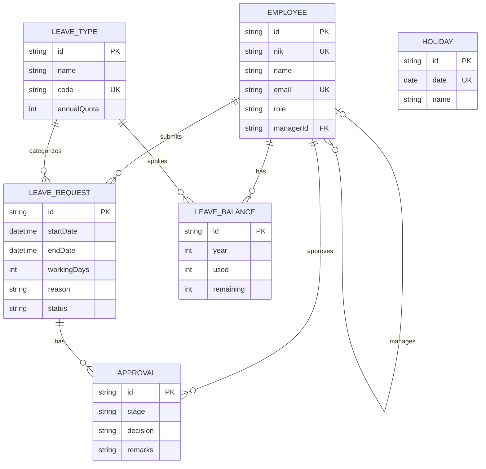

# HRIS Leave System

## Product scope

Employee mengajukan dan membatalkan cuti yang masih PENDING. Manajer menangani approval tahap pertama, HR Admin menangani tahap kedua untuk permintaan lebih dari tiga hari kerja. HR Admin juga menambahkan hari libur nasional. Perubahan saldo dilakukan pada approval akhir di dalam transaksi PostgreSQL.

## Role dan status

- Role simulasi: `EMPLOYEE`, `MANAGER`, `HR_ADMIN`.
- Status pengajuan: `PENDING`, `APPROVED`, `REJECTED`, `CANCELLED`.
- Status approval: `PENDING`, `APPROVED`, `REJECTED`, `NOT_REQUIRED`.
- Semua pengajuan melalui Manajer. Jika `workingDays > 3`, approval HR Admin dibuat setelah approval Manajer disetujui.

## ERD



Tabel `LeaveType` dipetakan ke `leave_types`; tabel `Holiday` dipetakan ke `public_holidays`.

## API

Aksi pengguna memakai header simulasi `x-actor-id` yang berisi ID Employee dari database. Header ini hanya untuk demo lokal, bukan mekanisme autentikasi produksi.

### Bootstrap dan data pribadi
- `GET /api/v1/bootstrap?userId={employeeId}`: profil aktif, pengguna, KPI, jenis cuti, dan hari libur.
- `GET /api/v1/leaves/requests?status=PENDING`: daftar pengajuan milik pengguna aktif.
- `POST /api/v1/leaves/requests`: buat pengajuan dan tahap approval Manajer.

```json
{
  "leaveTypeId": "cuid",
  "startDate": "2026-12-01",
  "endDate": "2026-12-03",
  "reason": "Liburan keluarga"
}
```

### Aksi dan pengaturan
- `PATCH /api/v1/leaves/requests/{id}/cancel`: batalkan pengajuan PENDING milik pengguna.
- `GET /api/v1/approvals`: inbox approval aktif bagi pengguna.
- `POST /api/v1/approvals/{requestId}/decide`: keputusan tahap pengguna.
- `GET /api/v1/settings/holidays`: daftar `public_holidays` dan `leave_types`.
- `POST /api/v1/settings/holidays`: tambah hari libur (role `HR_ADMIN`).

```json
{
  "decision": "APPROVED",
  "remarks": "Disetujui"
}
```
